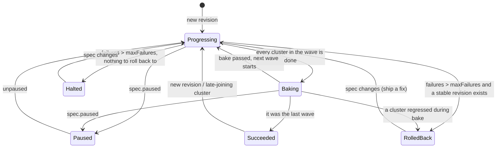

# fleetwave design note

Status: implemented (v1alpha1). Author: Anirudh Babu.

## Problem

A platform team that runs many Kubernetes clusters needs to ship changes to
all of them: a new ingress controller version, a DNS or cert-manager config,
an agent DaemonSet. Applying to every cluster at once turns one bad change into
a fleet-wide outage. Applying by hand, cluster by cluster, does not scale past
a handful of clusters and depends on someone watching dashboards.

fleetwave rolls a set of Kubernetes objects across a fleet in **waves**, waits
for each wave to be **healthy and stay healthy for a bake period**, halts on
failure, and **rolls the whole fleet back** to the last revision that worked
everywhere.

### Goals

- Blast radius control: a canary cluster first, then a percentage, then everyone.
- Decisions based on the workloads' own status, not on "the apply succeeded".
- Automatic rollback to a known-good revision, with the reason recorded.
- Safe to restart at any point: all state lives in the API, applies are idempotent.
- Cheap enough on the hub for a fleet of 160+ clusters.

### Non-goals

- Pod-level canaries inside one cluster (that is Argo Rollouts' job; fleetwave
  can ship a Rollout object like any other).
- Replacing Argo CD or Flux. A natural setup is GitOps on the hub: Argo CD syncs
  `FleetRollout` objects from Git, fleetwave fans them out to members.
- Templating per cluster. Every selected cluster gets the same manifests.

## API

Two CRDs in `fleet.fleetwave.io/v1alpha1`.

**MemberCluster** (cluster-scoped) registers a cluster: a reference to a
kubeconfig Secret, labels for selection, and `spec.cordoned`. The default Secret
key is `value`, the key Cluster API uses for `<cluster>-kubeconfig`, so
CAPI-provisioned clusters can be registered without copying credentials. The
controller probes each member's discovery endpoint and publishes a `Ready`
condition and the Kubernetes version.

**FleetRollout** (namespaced) is the unit of change:

```yaml
spec:
  clusterSelector: {matchLabels: {env: prod}}
  strategy:
    waves: ["1", "25%", "100%"]   # cumulative targets; last wave is forced to 100%
    bakeTime: 10m
    progressDeadline: 5m
    maxFailures: 0
    autoRollback: true
  resources: [ ...plain Kubernetes objects... ]
```

Status carries the phase, current wave, the content-hash revision being rolled
out, the stable revision (last one that reached every selected cluster), and a
per-cluster list of wave, applied revision, state and a human-readable message.

Why namespaced rollouts and cluster-scoped members: members are shared fleet
infrastructure owned by the platform team; rollouts belong to the teams that
ship things, and hub RBAC can scope who may create them per namespace.

## How a reconcile works

The controller is split into an **impure shell** and a **pure planner**.

1. Parse and validate `spec.resources`, compute a 10-hex content hash, and
   store the manifests as an `apps/v1 ControllerRevision` (the same history
   mechanism StatefulSets use), owned by the FleetRollout.
2. List selected MemberClusters and cut them into waves: canary-labelled
   clusters first, then by name, so the plan is stable across reconciles.
3. For clusters already on the desired revision, read every applied object back
   from the member (in parallel, bounded) and assess health.
4. Hand all observations to `planner.Plan`, which returns state transitions and
   actions: apply, re-apply (drift), or roll back.
5. Execute the actions in parallel with a concurrency bound, write status,
   emit events and metrics, and requeue.

The planner has no clients, clock or goroutines; time is an input. Every rule
below is a table-driven unit test.



### Rules worth calling out

- **Cluster states.** Pending → Progressing (applied) → Healthy, or Failed when
  a workload reports a terminal failure (e.g. Deployment
  `ProgressDeadlineExceeded`, Job `Failed`) or does not converge within
  `progressDeadline`. A cluster that was Healthy and goes unhealthy **during the
  bake** is Failed with "regressed after becoming healthy". That is the point
  of baking.
- **Done** means Healthy, Skipped (cordoned) or Failed within budget. A wave
  starts only after the previous one is done *and* `bakeTime` has passed since
  it became done.
- **Unreachable clusters block, they are not skipped.** Silently skipping a
  cluster that might come back on an old revision hides drift. The way out is
  explicit: set `spec.cordoned: true` on the MemberCluster.
- **Halted and RolledBack are sticky.** Nothing moves until the spec changes,
  so the system never retries a known-bad revision on its own. Shipping a fix
  is a Git commit, which fits GitOps.
- **Rollback is fleet-wide.** Clusters that were healthy on the bad revision
  also go back, so the fleet converges on one known version instead of a mix.
- **Pause** stops new applies and wave advances, but health is still tracked
  and failures still trigger rollback.
- **Late joiners.** A cluster that starts matching the selector after a rollout
  succeeded gets the stable revision straight away.

## Applying to members

- **Server-side apply** with field manager `fleetwave` and forced ownership of
  the fields fleetwave sets. Re-applying is idempotent, which is what makes
  restarts and drift correction safe.
- **Ownership guard.** Before applying, fleetwave reads the live object. If it
  carries another rollout's `fleet.fleetwave.io/owner` annotation, the apply is
  rejected instead of silently taking the object over. Two teams pointing at
  the same ConfigMap get a clear failure, not a tug of war.
- **Apply order.** Namespaces, then CRDs, then RBAC and config, then workloads,
  so one revision can create a namespace and what lives in it.
- **Pruning.** When a cluster moves from revision A to B, objects in A's
  inventory that are not in B are deleted, only if fleetwave still owns them,
  with a UID precondition.
- **Permanent vs transient errors.** Validation errors, Forbidden, unknown
  kinds and ownership conflicts fail the cluster immediately (waiting will not
  help). Timeouts and connection errors keep it Pending and retry.
- **Deletion.** A finalizer deletes everything the rollout applied, per
  cluster, from the revision recorded for that cluster. A cordoned or
  deregistered cluster is skipped so deletion cannot hang forever on a cluster
  that is gone. `deletionPolicy: Orphan` leaves member objects in place.

## Health model

| Kind | Healthy when | Failed when |
|---|---|---|
| Deployment | generation observed, all replicas updated, old replicas gone, all available | `Progressing=False, ProgressDeadlineExceeded` |
| StatefulSet | generation observed, replicas updated and ready, current = update revision | progress deadline |
| DaemonSet | generation observed, every scheduled node updated and available | progress deadline |
| Job | `Complete=True` | `Failed=True` |
| Anything with a `Ready` condition | `Ready=True` | progress deadline |
| Everything else | exists | progress deadline |

Per-object results fold into one verdict per cluster: Degraded beats Unknown
beats Progressing beats Healthy, and the message names the object that is
holding the cluster back ("Deployment/checkout: 0 of 3 updated replicas
available").

## Failure modes

| What happens | Behaviour |
|---|---|
| Hub controller restarts mid-wave | All state is in status and ControllerRevisions; the next reconcile re-observes and continues. Applies are idempotent. Two replicas with leader election. |
| Member API server unreachable | MemberCluster `Ready=False`. Pending clusters block their wave with "cluster is not Ready". In-flight clusters time out against `progressDeadline`. A Healthy cluster with an unknown health read is not treated as a regression. |
| Apply half-succeeds then a rejection | Cluster is recorded on the new revision and Failed, so rollback cleans it up. |
| Rollback apply fails | RolledBack phase keeps retrying the clusters still on the bad revision. |
| Kubeconfig rotated | Clients are cached per Secret resourceVersion; a metadata watch on Secrets re-probes affected clusters immediately. |
| Spec edited mid-rollout | New revision, restart from wave 1. The stable revision stays the last one that fully succeeded. |
| Someone edits an object in a member by hand | A succeeded rollout re-applies every `--drift-interval` (default 10m). |
| Old revisions pile up | Keep the newest 5 ControllerRevisions plus any still referenced by the stable revision or a cluster. |

## Scale (160+ clusters)

- **No informers on members.** An informer per kind per member in one hub
  process means hundreds of long-lived watches and caches of objects the hub
  rarely reads. fleetwave uses plain GETs, and only for clusters that are
  in flight in a rollout that is not finished. Steady state costs one discovery
  call per cluster per probe interval, plus one re-apply per cluster every
  `--drift-interval` for finished rollouts.
- **Bounded parallelism** (`--apply-concurrency`, default 10) per reconcile,
  and per-member client QPS limits, so a wave of 80 clusters does not open 80
  connections at once.
- **Small hub cache.** Secrets are watched as metadata only (the hub never
  caches kubeconfig contents) and read with an uncached reader when needed.
  ControllerRevisions are cached only if they carry fleetwave's label.
- **Status size.** About 250 bytes per cluster entry, so 160 clusters is roughly
  40 KB, far below the etcd object limit. Past a few thousand clusters, per
  cluster status would move to its own object.
- **Fewer no-op writes.** MemberCluster status is only written when something
  changed (or the last write is stale), not on every 30s probe.

## Observability

- Metrics: `fleetwave_rollout_phase`, `fleetwave_rollout_clusters{state}`,
  `fleetwave_rollout_current_wave`, `fleetwave_rollout_total_waves`,
  `fleetwave_member_cluster_ready`, `fleetwave_cluster_apply_duration_seconds`,
  `fleetwave_rollbacks_total`, plus controller-runtime's reconcile metrics.
  Example alert: `max by (namespace, rollout) (fleetwave_rollout_phase{phase=~"RolledBack|Halted"}) == 1`.
- Events on the FleetRollout: `NewRevision`, `WaveCompleted`, `WaveStarted`,
  `ClusterFailed`, `RolledBack`, `Halted`, `Succeeded`, `ApplyRejected`.
- Conditions: `Ready`, `Progressing`, `Degraded`, with `observedGeneration`.

## Security

- The hub ServiceAccount can read Secrets cluster-wide because kubeconfig
  Secrets can live anywhere; scope it down with a Role per namespace if they
  live in one place.
- Member kubeconfigs should be least privilege for what the fleet ships.
  fleetwave only needs get/create/patch/delete on those kinds plus discovery.
- Manager image is distroless, non-root, read-only root filesystem, all
  capabilities dropped, `restricted` Pod Security on its namespace.

## Testing

- `internal/planner`: table tests for wave maths and every state transition
  above, with an injected clock (no sleeps).
- `internal/health`, `internal/revision`: object health, hashing, ordering,
  pruning inventory.
- `internal/controller`: integration tests against **four real API servers**
  (a hub plus three members, each envtest kube-apiserver + etcd) with a
  simulated kubelet. They cover baked waves, a region-specific bad release with
  fleet-wide rollback, pruning, ownership conflicts, finalizer cleanup, pause,
  an unreachable cluster unblocked by cordoning, invalid specs, and that the
  README samples pass CRD validation. Everything runs under `-race`.
- `make demo` drives the same harness as a narrated walkthrough.

## What I would do next

1. **Metric-based analysis gates**: a wave also waits on a PromQL query
   (error rate, p99) per cluster, the way Argo Rollouts AnalysisTemplates work.
2. **Manual approval between waves** for high-risk changes (today `paused` does
   this coarsely).
3. **Cluster API integration**: auto-register a MemberCluster for each CAPI
   `Cluster` that becomes Provisioned.
4. **Clusters that stop matching the selector** keep their objects today
   (orphaned). Add an explicit `removalPolicy`.
5. **Sharding** rollouts across hub replicas by hash once a single leader
   becomes the bottleneck.
6. Server-side dry-run of a revision against every member before wave 1, to
   catch admission rejections before they reach the canary.
